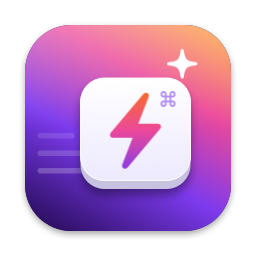

# QuickLaunch for macOS

**Website:** https://giridharmb.github.io/MacOSX_QuickLaunch_Docs/ · [Docs](https://giridharmb.github.io/MacOSX_QuickLaunch_Docs/docs.html) · [Support](https://giridharmb.github.io/MacOSX_QuickLaunch_Docs/support.html) · [Release notes](RELEASE_NOTES.md)

QuickLaunch lives in your menu bar and opens anything with a keyboard shortcut. You can bind
apps, websites, files and folders, shell commands, and Shortcuts.app shortcuts. Before a shortcut
is saved, QuickLaunch checks that it is free, and your setup syncs through iCloud Drive.

Requires macOS 14 Sonoma or later. QuickLaunch does not need Accessibility permission.

## Features

### Quick access
- **Leader key**: press one shortcut (for example ⌃Space), then a single letter, such as C for Chrome.
  Letters are picked automatically from link names, or you can set your own. One combination covers everything.
- **Search launcher**: a Spotlight-style box with fuzzy search over all your links. Your most used links come first.
  Use ↑/↓ and ↩ to choose, or ⌘1–⌘9.
- **Cheat sheet**: shows every shortcut you have, grouped, over the current screen.
- **Workspaces**: one shortcut opens several links at once, for example Slack, Chrome on a dashboard and iTerm.
- **Add the frontmost app** from the menu bar menu in one click.

### Smarter shortcuts
- **Pause in certain apps**: shortcuts switch off automatically while chosen apps are in front, such as games,
  VMs or Screen Sharing.
- **Cycle windows** *(Accessibility)*: pressing an app's shortcut again moves to its next window.
- **Window placement** *(Accessibility)*: open an app at left half, right half, top half, bottom half, maximized or centered,
  on the screen your pointer is on.
- **App menu conflict scan** *(Accessibility)*: also warns when a combination is used in a running app's menus.
- **Insights**: how often each link is used, shortcuts you never use, and apps you open often by hand without a
  shortcut (with a one-click Add). Stats stay on your Mac.
- **Automatic updates** via Sparkle.

### Core

- **Global shortcuts** for applications, URLs, files/folders, shell commands and Shortcuts.app shortcuts.
- **Conflict checking** when you record a shortcut. QuickLaunch warns you if it is already used by:
  - another QuickLaunch link,
  - a macOS system shortcut (Spotlight, Mission Control, screenshots, …),
  - another app's global hotkey,
  - a common in-app shortcut such as ⌘C (a warning only).
- **Live status per link**: green = active, orange = active with a warning, red = unavailable.
  Hover over the icon to see why.
- **Test before you trust it**:
  - ▶︎ runs the action right away.
  - *Test Action* in the editor runs it before you save.
  - Each row shows *Triggered just now* when you press its shortcut.
  - *Test mode* in Settings makes shortcuts show an on-screen confirmation without launching anything.
- **Groups** shown as menu sections or submenus. You can drag rows to reorder them and right-click to move a link to another group.
- **Drag & drop** apps, files or folders from Finder into the Manage window.
- **Search** across all groups by name, path or shortcut.
- **Toggle apps**: pressing an app's shortcut while that app is in front hides it.
- **Recent items** in the menu bar menu.
- **Pause all shortcuts** with one click, for example while gaming or screen sharing.
- **Choose the browser** used for URL links.
- **iCloud Drive sync** across your Macs, plus JSON **Import / Export** (merge or replace).
- **Launch at login**, plus options to show or hide the menu bar icon and the Dock icon.

## Getting started

1. Open QuickLaunch. A ⌘ icon appears in the menu bar.
2. Choose **Manage QuickLaunch…**, then click **+ → Application…** (or drag an app into the window).
3. Click **Record Shortcut** and press a combination such as ⌃⌥⌘C.
   - Esc cancels and ⌫ clears.
   - If the combination is taken, QuickLaunch tells you by whom. You can pick another one or assign it anyway.
4. Press the shortcut from any app. The row shows *Triggered just now*.

**Tip:** combinations that use ⌃⌥⌘ (or include ⌃ or ⌥) rarely collide with app shortcuts.

## Link types

| Type | What it does |
|------|--------------|
| Application | Opens or focuses the app. Pressing the shortcut again hides it (optional). |
| URL | Opens in your chosen browser. Any URL scheme works (`mailto:`, `slack://`, …). |
| File or Folder | Opens with its default app. `~` is allowed. |
| Shell Command | Runs with `/bin/zsh -lc` in your home folder. You get a notification if it fails. |
| Shortcuts.app Shortcut | Runs a shortcut from the Shortcuts app by name. |
| Workspace | Opens several of your other links in order. |

## Accessibility permission (optional)

QuickLaunch's shortcuts never need it. Turn it on under **Settings › Accessibility** only if you want window
cycling, window placement, or the app-menu conflict scan.

## iCloud sync

Turn it on in **Settings › iCloud**. Your links and settings are saved to
`iCloud Drive/QuickLaunch/QuickLaunch.json`, and every Mac with sync turned on picks up changes
automatically.

When two Macs change things, the most recent change wins. The copy it replaces is backed up in
`~/Library/Application Support/QuickLaunch/`. iCloud Drive must be enabled in
System Settings › Apple Account › iCloud.

## FAQ

**A shortcut shows red "already registered by another app".**
Another running app owns that combination. Pick a different one, or change it in the other app.

**It shows orange "used by a macOS system shortcut".**
macOS usually wins. Change or disable the system shortcut in System Settings › Keyboard ›
Keyboard Shortcuts, or choose another combination.

**Can QuickLaunch detect every conflict?**
It can detect system shortcuts, other QuickLaunch links, and apps that claim their hotkeys
exclusively. Some apps register hotkeys non-exclusively, and in-app menu shortcuts are invisible to
other apps; macOS offers no way to see those. Use *Test mode* to confirm a shortcut reaches QuickLaunch.

**I hid the menu bar icon. How do I get back to QuickLaunch?**
Open QuickLaunch again from Finder, Spotlight or Launchpad. The Manage window opens, and your shortcuts keep working the whole time.

**How does the leader key pick letters?**
A letter you set in the link editor always wins. Other links get the first unused letter of their name.
The Manage window shows each link's letter once a leader shortcut is set.

**Where are my settings stored?**
`~/Library/Application Support/QuickLaunch/config.json` (Settings › About › Open Settings Folder).

See [RELEASE_NOTES.md](RELEASE_NOTES.md) for version history.
